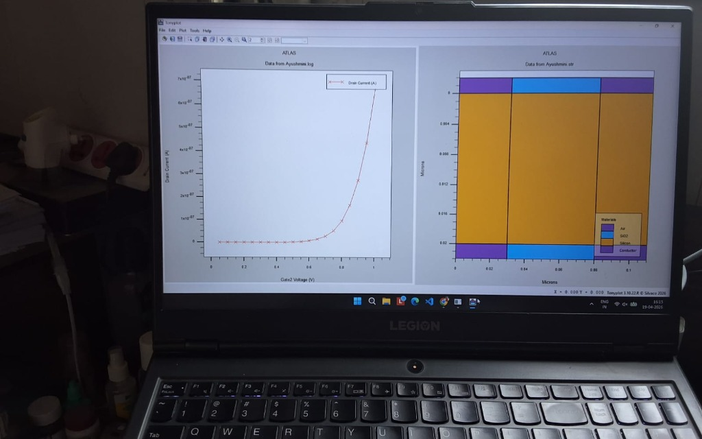
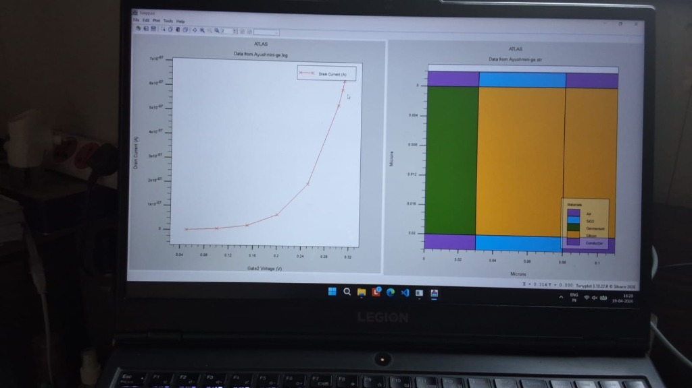
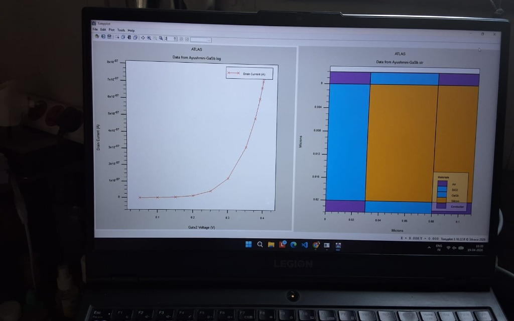
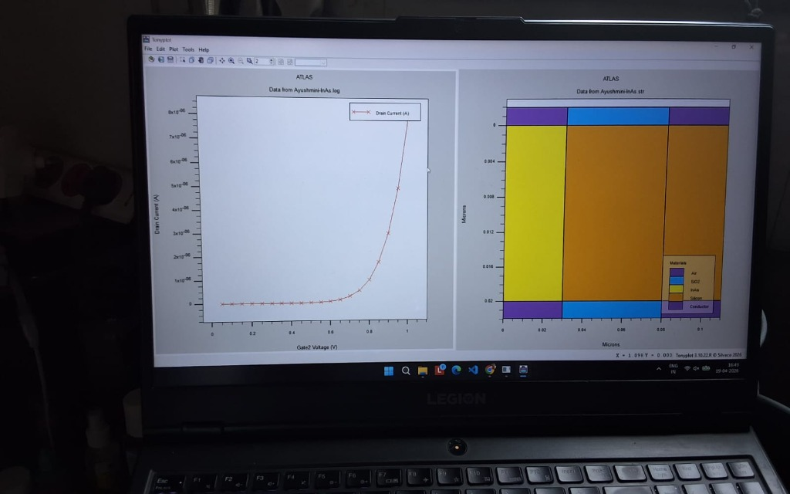

<div align="center">

# 🔬 Double-Gate Heterojunction Tunnel FET (DG-TFET)
### Silvaco Atlas TCAD Simulation & Comparative Material Performance Analysis

[](https://silvaco.com/)
[-8A2BE2?style=for-the-badge)](#physics--operating-principles)
[-00599C?style=for-the-badge)](#device-architecture--dimensions)
[-50%20nm-008080?style=for-the-badge)](#device-architecture--dimensions)
[](#comparative-performance-analysis)
[](#simulation-results--iv-characteristics)
[](LICENSE)

<br/>

<p align="center">
  <b>A comprehensive Nanoelectronics & VLSI device simulation project modeling Double-Gate Tunnel Field-Effect Transistors.</b><br/>
  Investigates steep subthreshold swing ($SS < 60\text{ mV/dec}$) and ON-state current enhancement through <b>heterojunction engineering</b> at the source-channel interface using <b>Silicon (Si)</b>, <b>Germanium (Ge)</b>, <b>Gallium Antimonide (GaSb)</b>, and <b>Indium Arsenide (InAs)</b>.
</p>

</div>

---

## 🛠️ Technology Stack & Simulation Environment

<table>
  <tr>
    <td align="center" width="25%"><b>Domain</b></td>
    <td align="center"><b>Tools, Models & Colorful Cards</b></td>
  </tr>
  <tr>
    <td align="center"><b>TCAD Simulator</b></td>
    <td>
      
      
      
    </td>
  </tr>
  <tr>
    <td align="center"><b>Device Type</b></td>
    <td>
      
      
      
    </td>
  </tr>
  <tr>
    <td align="center"><b>Quantum & Physical Models</b></td>
    <td>
      
      
      
      
    </td>
  </tr>
  <tr>
    <td align="center"><b>Heterojunction Materials</b></td>
    <td>
      
      
      
      
    </td>
  </tr>
  <tr>
    <td align="center"><b>Numerical Solver</b></td>
    <td>
      
      
    </td>
  </tr>
</table>

---

## 📐 Device Architecture & Dimensions

The simulated device is a symmetric **Double-Gate (DG) $p^+-i-n^+$ Tunnel FET** designed to maximize electrostatic gate control and minimize short-channel effects (SCEs).

```mermaid
graph TD
    subgraph TopGate [Gate 1 (Top)]
        G1[Metal Gate 1: Workfunction = 4.07 eV]
    end

    subgraph TopOxide [Top Dielectric]
        OX1["SiO2 (Tox = 2 nm, Length = 50 nm)"]
    end

    subgraph SemiconductorBody [Semiconductor Channel / Body (Tbody = 20 nm)]
        Source["Source (Region 4)<br/><b>p+ Doping: 1e20 cm⁻³</b><br/>Length: 30 nm<br/><i>[Si / Ge / GaSb / InAs]</i>"]
        Channel["Channel (Region 5)<br/><b>Intrinsic/n- Doping: 1e15 cm⁻³</b><br/>Length: 50 nm<br/><i>[Silicon]</i>"]
        Drain["Drain (Region 6)<br/><b>n+ Doping: 5e18 cm⁻³</b><br/>Length: 30 nm<br/><i>[Silicon]</i>"]
    end

    subgraph BottomOxide [Bottom Dielectric]
        OX2["SiO2 (Tox = 2 nm, Length = 50 nm)"]
    end

    subgraph BottomGate [Gate 2 (Bottom)]
        G2[Metal Gate 2: Common to Gate 1]
    end

    G1 --> OX1
    OX1 --> Channel
    Source --- Channel --- Drain
    Channel --> OX2
    OX2 --> G2

    style Source fill:#2E7D32,stroke:#fff,stroke-width:2px,color:#fff
    style Channel fill:#F57C00,stroke:#fff,stroke-width:2px,color:#fff
    style Drain fill:#D32F2F,stroke:#fff,stroke-width:2px,color:#fff
    style G1 fill:#1565C0,stroke:#fff,stroke-width:2px,color:#fff
    style G2 fill:#1565C0,stroke:#fff,stroke-width:2px,color:#fff
    style OX1 fill:#0288D1,stroke:#fff,stroke-width:2px,color:#fff
    style OX2 fill:#0288D1,stroke:#fff,stroke-width:2px,color:#fff
```

### Physical Specifications
| Parameter | Value | Description |
| :--- | :--- | :--- |
| **Total Device Length ($L_{total}$)** | $110\text{ nm}$ | Source ($30\text{ nm}$) + Channel ($50\text{ nm}$) + Drain ($30\text{ nm}$) |
| **Gate Length ($L_g$)** | $50\text{ nm}$ | Extends over the intrinsic silicon channel region |
| **Body Thickness ($T_{body}$)** | $20\text{ nm}$ | Ultra-thin body ensuring excellent gate controllability |
| **Gate Oxide Thickness ($T_{ox}$)** | $2\text{ nm}$ | $\text{SiO}_2$ dielectric ($\epsilon_r = 3.9$) |
| **Source Doping ($N_A$)** | $1 \times 10^{20}\text{ cm}^{-3}$ | Heavy p-type degenerate doping |
| **Channel Doping ($N_D$)** | $1 \times 10^{15}\text{ cm}^{-3}$ | Lightly doped n-type (near-intrinsic) |
| **Drain Doping ($N_D$)** | $5 \times 10^{18}\text{ cm}^{-3}$ | Moderate n-type doping to suppress ambipolar conduction |
| **Gate Metal Workfunction ($\Phi_M$)** | $4.07\text{ eV}$ | Symmetric top and bottom gates (`gate1` and `gate2`) |

---

## ⚡ Physics & Operating Principles

### 1. Breaking the "Boltzmann Tyranny" ($SS < 60\text{ mV/dec}$)
Conventional MOSFETs rely on **thermionic emission** over a potential barrier. The subthreshold swing ($SS$) is governed by Fermi-Dirac thermal carrier spreading:
$$SS = \ln(10) \cdot \frac{k_B T}{q} \left(1 + \frac{C_d}{C_{ox}}\right) \ge 60\text{ mV/dec}\quad (\text{at } T = 300\text{ K})$$

In contrast, a **Tunnel FET** operates via **quantum mechanical Band-to-Band Tunneling (BTBT)**. Energetic electrons from the high-energy thermal tail are filtered out by the semiconductor bandgap, allowing $SS < 60\text{ mV/dec}$ at room temperature, enabling ultra-low supply voltage ($V_{DD} < 0.5\text{ V}$) computing.

### 2. Kane's Nonlocal BTBT Model
The tunneling generation rate ($G_{BTBT}$) is given by Kane's two-band formulation:
$$G_{BTBT} = A \cdot E^D \cdot \exp\left(-\frac{B}{E}\right)$$
Where:
- $E$ is the local electric field across the tunneling junction.
- $B \propto \frac{\pi \sqrt{m_r^*}\, E_g^{3/2}}{2 q \hbar}$ (Tunneling barrier parameter).
- $m_r^*$ is the carrier tunneling effective mass: $\frac{1}{m_r^*} = \frac{1}{m_e^*} + \frac{1}{m_h^*}$.
- $E_g$ is the material bandgap.

### 3. Why Heterojunction Engineering?
In a homojunction Silicon TFET, the large bandgap of Si ($1.12\text{ eV}$) and large tunneling mass ($m_e^* = 0.20, m_h^* = 0.24$) result in a very high tunneling barrier $B$, limiting the ON-state current ($I_{ON}$) to nanoampere levels.

By engineering a **Heterojunction** using low-bandgap source materials:
1. The tunneling barrier width ($\lambda$) is drastically reduced.
2. The effective bandgap at the tunneling interface shrinks (forming a staggered **Type-II** or broken-gap band alignment).
3. The lower effective mass exponentially boosts the tunneling transmission probability $T(E)$, dramatically elevating $I_{ON}$.

---

## 📊 Comparative Material Properties

| Property | Silicon (Si) [Baseline] | Germanium (Ge) | Gallium Antimonide (GaSb) | Indium Arsenide (InAs) |
| :--- | :--- | :--- | :--- | :--- |
| **Material Group** | Group IV | Group IV | III-V Compound | III-V Compound |
| **Energy Bandgap ($E_g$)** | $1.12\text{ eV}$ (Indirect) | $0.66\text{ eV}$ (Indirect) | $0.726\text{ eV}$ (Direct) | $0.354\text{ eV}$ (Direct) |
| **Electron Tunnel Mass ($m_e^*$)** | $0.20\, m_0$ | $0.082\, m_0$ | $0.041\, m_0$ | **$0.026\, m_0$** |
| **Hole Tunnel Mass ($m_h^*$)** | $0.24\, m_0$ | $0.044\, m_0$ | $0.040\, m_0$ | **$0.036\, m_0$** |
| **Electron Affinity ($\chi$)** | $4.05\text{ eV}$ | $4.00\text{ eV}$ | $4.00\text{ eV}$ | **$4.96\text{ eV}$** |
| **Junction Type with Si** | Homojunction | Type-II Staggered | Type-II Staggered | Broken-Gap / Staggered |

---

## 📈 Simulation Results & Transfer Characteristics ($I_D - V_{GS}$)

The simulations were executed in **Silvaco Atlas** under drain bias $V_{DS} = 1.0\text{ V}$ and swept gate bias $V_{GS} = 0\text{ V} \to 1.0\text{ V}$.

### 1. Silicon (Si) Homojunction Baseline
The homojunction Si TFET requires higher gate voltages ($V_{GS} > 0.7\text{ V}$) to initiate band-to-band tunneling due to the wide Silicon bandgap.
- **Max $I_D$**: $\sim 0.7\ \mu\text{A}$ at $V_{GS} = 1.0\text{ V}$
- **Turn-on threshold**: Requires high $V_{GS}$ ($> 0.65\text{ V}$)

<div align="center">
  
  <p><i>Figure 1: Atlas 2D Structure and Transfer Characteristics for Homojunction Silicon DG-TFET.</i></p>
</div>

---

### 2. Germanium (Ge) Source Heterojunction
Introducing Germanium ($E_g = 0.66\text{ eV}$) at the source significantly narrows the tunneling barrier, initiating tunneling at much lower gate voltages.
- **Max $I_D$**: $\sim 0.65\ \mu\text{A}$ at just **$V_{GS} = 0.32\text{ V}$**
- **Turn-on**: Extremely steep subthreshold turn-on starting around $V_{GS} = 0.15\text{ V}$

<div align="center">
  
  <p><i>Figure 2: Structure and Id-Vg characteristics for Ge-Source / Si-Channel DG-TFET.</i></p>
</div>

---

### 3. Gallium Antimonide (GaSb) Source Heterojunction
GaSb features very small effective carrier masses ($m_e^* = 0.041, m_h^* = 0.040$) and a direct bandgap, enhancing the density of tunneling states.
- **Max $I_D$**: $\sim 0.7\ \mu\text{A}$ at **$V_{GS} = 0.40\text{ V}$**
- **Steep slope**: Rapid current escalation between $0.25\text{ V}$ and $0.40\text{ V}$

<div align="center">
  
  <p><i>Figure 3: Structure and Id-Vg characteristics for GaSb-Source / Si-Channel DG-TFET.</i></p>
</div>

---

### 4. Indium Arsenide (InAs) Source Heterojunction
InAs boasts the narrowest bandgap ($0.354\text{ eV}$) and ultra-light tunneling mass ($m_e^* = 0.026$). Its large electron affinity ($4.96\text{ eV}$) forms a near-broken band alignment with Silicon, yielding an **order-of-magnitude increase in ON-current**.
- **Max $I_D$**: **$\sim 8.2\ \mu\text{A}$** at $V_{GS} = 1.0\text{ V}$
- **Performance**: Delivers the highest drive current among all evaluated configurations.

<div align="center">
  
  <p><i>Figure 4: Structure and Id-Vg characteristics for InAs-Source / Si-Channel DG-TFET.</i></p>
</div>

---

## 🏆 Comparative Performance Summary

| Architecture | Source Material | Turn-On Voltage ($V_{ON}$) | Peak $I_D$ | Driving Capability | Primary Advantage |
| :--- | :--- | :--- | :--- | :--- | :--- |
| **Si Homojunction** | Silicon (Si) | $\sim 0.65\text{ V}$ | $0.7\ \mu\text{A}$ (@ $1.0\text{ V}$) | Baseline | CMOS process compatibility |
| **Ge Heterojunction** | Germanium (Ge) | **$\sim 0.15\text{ V}$** | $0.65\ \mu\text{A}$ (@ **$0.32\text{ V}$**) | High Speed at Ultra-Low $V_{DD}$ | Lowest threshold voltage |
| **GaSb Heterojunction** | Gallium Antimonide | $\sim 0.25\text{ V}$ | $0.72\ \mu\text{A}$ (@ **$0.40\text{ V}$**) | Excellent Low-Power Switching | High carrier mobility |
| **InAs Heterojunction** | Indium Arsenide | $\sim 0.60\text{ V}$ | **$8.2\ \mu\text{A}$** (@ $1.0\text{ V}$) | **Maximum Drive Current ($10\times$)** | Highest tunneling probability |

---

## 📁 Repository Organization

```text
Double-Gate-Heterojunction-TFET/
├── 📁 assets/
│   └── 📁 images/
│       ├── si_tfet_graph.jpg         # Tonyplot output for Si baseline TFET
│       ├── ge_tfet_graph.jpg         # Tonyplot output for Ge heterojunction TFET
│       ├── gasb_tfet_graph.jpg       # Tonyplot output for GaSb heterojunction TFET
│       └── inas_tfet_graph.jpg       # Tonyplot output for InAs heterojunction TFET
├── 📁 decks/
│   ├── si_homojunction_tfet.in       # Silvaco Atlas deck: Homojunction Si TFET
│   ├── ge_heterojunction_tfet.in     # Silvaco Atlas deck: Ge-source heterojunction
│   ├── gasb_heterojunction_tfet.in   # Silvaco Atlas deck: GaSb-source heterojunction
│   └── inas_heterojunction_tfet.in   # Silvaco Atlas deck: InAs-source heterojunction
├── 📄 .gitignore                     # Ignores *.log, *.str, and Tonyplot temporary files
└── 📄 README.md                      # Comprehensive project documentation
```

---

## 🚀 How to Run the Simulations

### Prerequisites
- **Silvaco TCAD Suite** (Atlas device simulator + DeckBuild environment).
- **Tonyplot** data visualization utility.

### Running via DeckBuild GUI
1. Launch **DeckBuild** from the command line or desktop shortcut:
   ```bash
   deckbuild &
   ```
2. Open any simulation deck (e.g., `decks/ge_heterojunction_tfet.in`).
3. Click the **Run** button (green arrow) to execute the simulation.
4. Tonyplot will automatically launch and display the 2D device structure (`.str`) and transfer characteristics (`.log`).

### Running from Terminal (Batch Mode)
To run Atlas in batch mode directly:
```bash
# Run Germanium heterojunction simulation
atlas decks/ge_heterojunction_tfet.in

# View generated structure and log curves
tonyplot Ayushmini-ge.log Ayushmini-ge.str
```

---

## 🎓 Viva & Technical Interview Notes

<details>
<summary><b>Click to expand Viva Q&A Cheat Sheet</b></summary>
<br/>

1. **What is the fundamental difference between a MOSFET and a TFET?**
   - A MOSFET works on **thermionic emission** over a gate-controlled barrier ($SS \ge 60\text{ mV/dec}$). A TFET works on **quantum Band-to-Band Tunneling (BTBT)** through a triangular barrier ($SS < 60\text{ mV/dec}$), eliminating the high-energy carrier tail.

2. **Why is a Double-Gate (DG) structure essential for TFETs?**
   - TFETs depend strongly on the electric field at the source-channel tunneling junction. A Double-Gate geometry provides superior electrostatic coupling from both top and bottom gates, significantly thinning the tunneling barrier ($\lambda$) and suppressing short-channel effects.

3. **Why does InAs give the highest drive current ($I_{ON}$)?**
   - InAs has an ultra-low direct bandgap ($0.354\text{ eV}$) and very low effective mass ($m_e^* = 0.026\, m_0$). In Kane's model, the barrier parameter $B \propto \sqrt{m^*} E_g^{3/2}$ is minimized, exponentially maximizing the tunneling generation rate $G_{BTBT}$.

4. **Why is the drain doping ($5 \times 10^{18}\text{ cm}^{-3}$) lower than the source doping ($1 \times 10^{20}\text{ cm}^{-3}$)?**
   - To suppress **ambipolar conduction**. When $V_{GS}$ becomes negative, tunneling can occur at the channel-drain interface. Lowering the drain doping widens the channel-drain barrier, preventing unwanted reverse leakage.

</details>

---

<div align="center">
  <sub>Developed by Ayush Raj • Built with ❤️ for Nanoelectronics & VLSI Research</sub>
</div>
